# BEZA Hub

**Podcasty, videa a články** na jednom místě. Android aplikace, kterou jsem si postavila pro sebe a svoje potřeby - abych už nemusela přecházet mezi třemi různými aplikacemi.


## O projektu

Tohle je kompletně vibe-codovaná aplikace: ani jediný řádek kódu nevznikl ručním psaním. Celá codebase vznikla v konverzaci s Claude Code. Moje role byla v roli architekta a designéra – zadávala jsem požadavky, testovala výsledek na vlastním telefonu a posílala iterativní připomínky, zatímco AI psala kód, řešila logiku a opravovala chyby.

Design a logika jsou ale plně moje. Vzhled, rozložení obrazovek, barvy, chování gest i drobnosti typu UX (umístění ikonek, filtry) jsem navrhovala já. AI fungovala jako extrémně rychlé „ruce“.

Projekt ještě není plně dokončený a vyladěný, stále ho testuju v praxi a postupně opravuju bugy, plynulost aplikace či přidávám nová vylepšení. 

## Co aplikace umí

### Podcasty
- **Odběry**: přidání podcastu adresou RSS nebo webu, mřížka obálek, **odznak s počtem nových epizod** na každé obálce.
- **Štítky**: podcasty se dají třídit do vlastních kategorií a podle nich filtrovat.
- **Fronta**: přetahováním řazená fronta k poslechu, přepínání nejnovější/nejstarší, filtr podle štítku.
- **Nové**: epizody, které jste ještě neslyšela, s filtrem období (dnes, týden, 14 dní, měsíc).
- **Detail podcastu**: přepínání filtru *vše / nepřehrané / přehrané* a řazení jedním klepnutím, hromadné označení epizod jako přehrané.
- **Detail epizody**: popis, **kapitoly** z popisku (klepnutím se skočí na místo v epizodě), sdílení.
- **Přehrávač**: minipřehrávač i celá obrazovka, přehrávání na pozadí a z notifikace, posun o 15 s zpět a o 30 s vpřed, rychlost, **časovač spánku**, po spuštění aplikace se hned obnoví naposledy puštěná epizoda tam, kde jsem skončila.
- **Stahování pro offline poslech**: tlačítkem v detailu epizody nebo swipem doleva ve frontě; stahuje se na pozadí a umí pokračovat po přerušení. Výchozí je jen přes Wi-Fi a po dohrání se epizoda sama smaže (obojí jde v nastavení změnit).
- **Gesta**: swipe doprava označí epizodu jako přehranou, swipe doleva ve frontě ji stáhne.

### YouTube
Kanály, nová videa, fronta videí a přehrávání přímo v aplikaci. Sledují se přes RSS, takže není potřeba žádný účet ani API klíč.

### Články
Odběr RSS zdrojů blogů a webů, seznam článků a čtečka s upraveným zobrazením.

### Nastavení a vzhled
- Světlý a tmavý režim (dokud ho nepřepnu, řídí se telefonem).
- Každá záložka má vlastní barvu zvýraznění; barvy jsou ověřené testem na čitelnost.

## Screenshoty

| Odběry | Fronta | Nové |
|:--:|:--:|:--:|
| 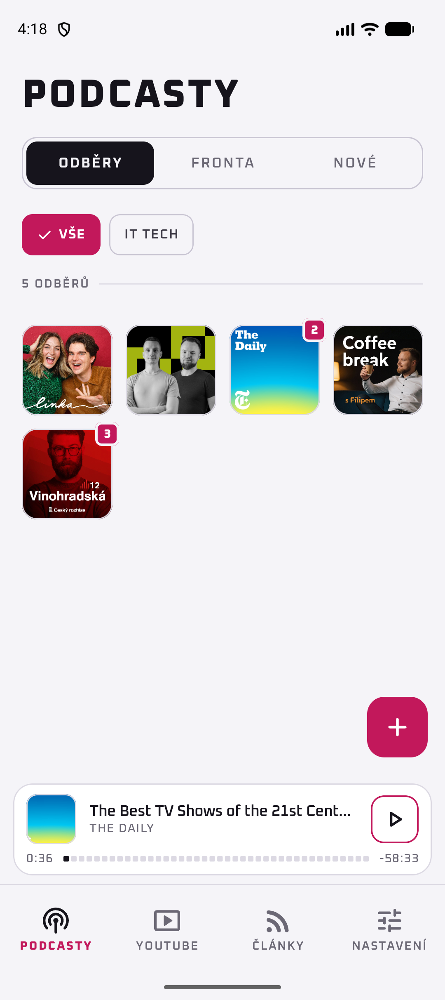 | 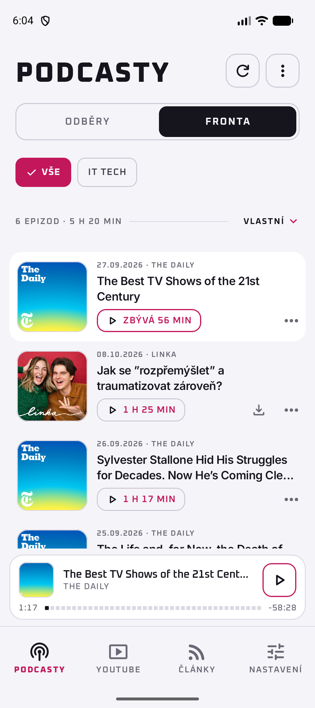 | 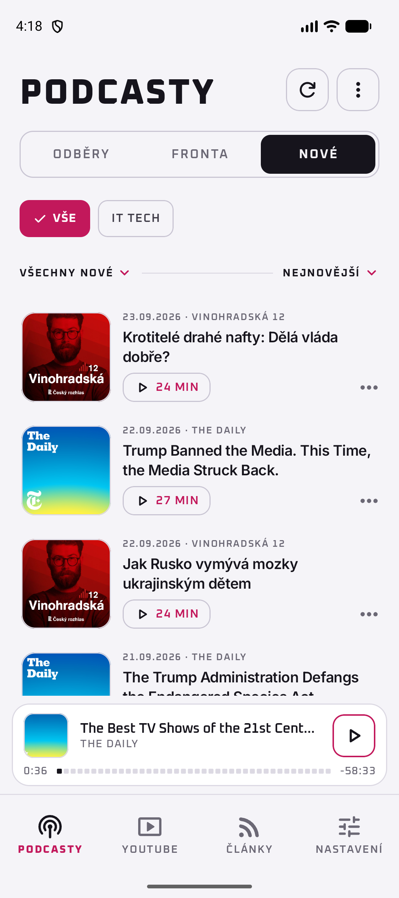 |

| Detail podcastu | Detail epizody | Přehrávač |
|:--:|:--:|:--:|
| 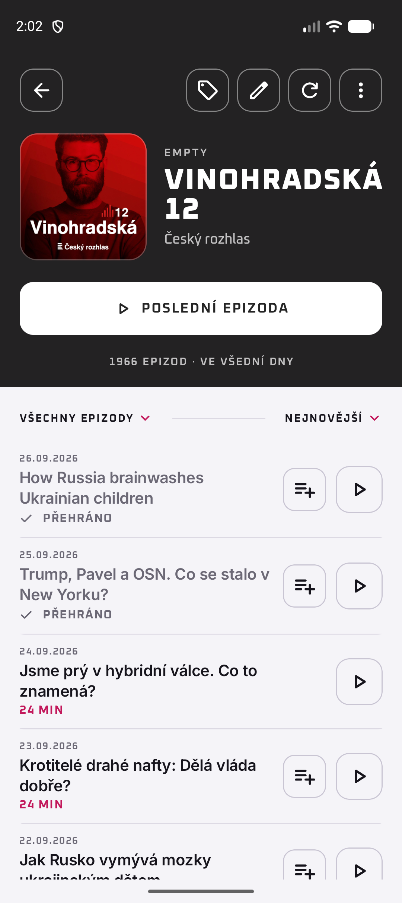 | 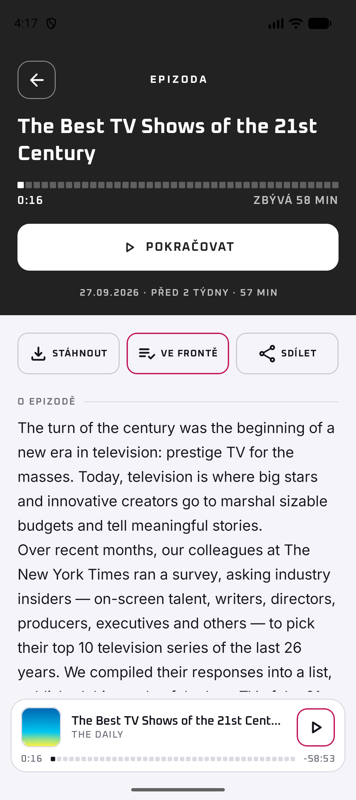 | 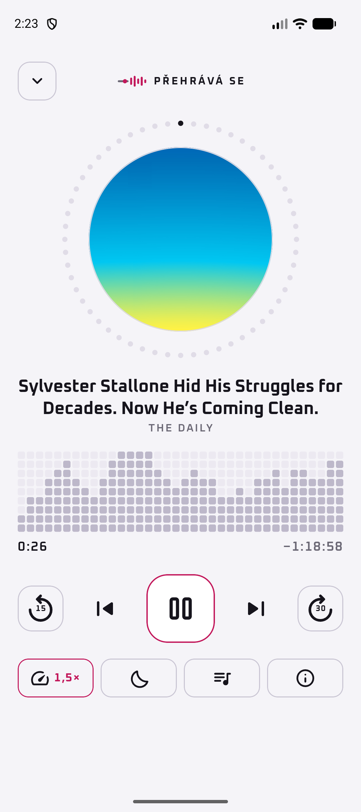 |

| YouTube | Články | Nastavení |
|:--:|:--:|:--:|
| 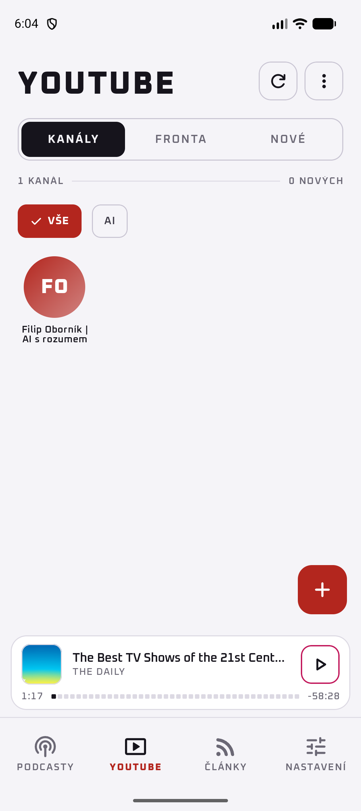 | 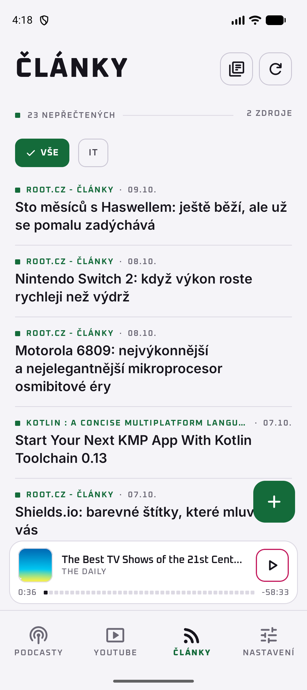 | 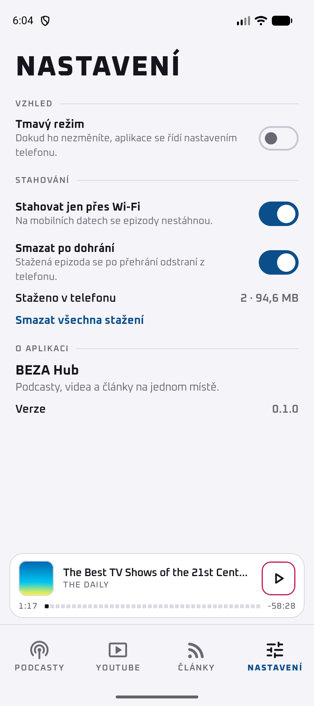 |

Aplikace má i tmavý režim, v něm se podcasty zvýrazňují světlejší růžovou:

<p>
  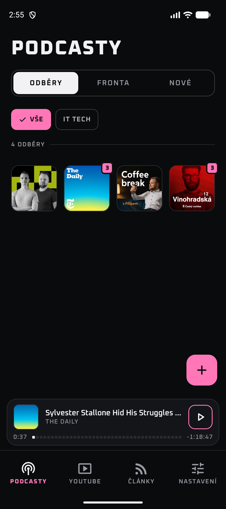
  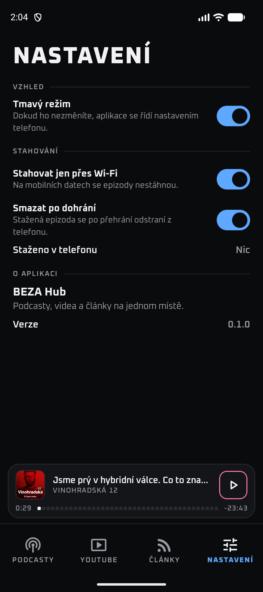
</p>

## Technologie

| Oblast | Použito |
|---|---|
| Jazyk, UI | Kotlin, Jetpack Compose, Material 3 |
| Databáze | Room (aktuálně schéma verze 11, s migracemi) |
| Přehrávání | Media3 (ExoPlayer + MediaSession), přehrávání na pozadí |
| Stahování | WorkManager, OkHttp (s navázáním přerušeného stahování) |
| Navigace | Navigation Compose |
| Obrázky | Coil |
| RSS | rssparser |
| YouTube | android-youtube-player |
| Řazení tažením | Reorderable |
| Testy | JUnit, kotlinx-coroutines-test |

Minimální verze Androidu je 8.0 (API 26).

### Architektura
Jednoduchá vrstvená architektura bez frameworku na DI:

- `data/local` – Room entity, DAO a migrace
- `data/remote` – načítání a parsování RSS
- `data/repository` – repozitáře a logika přehrávání, front a stahování
- `download` – stahování epizod na pozadí
- `playback` – hudební služba s MediaSession
- `ui/...` – obrazovky v Compose a jejich ViewModely (po funkcích: `podcasts`, `queue`, `player`, `youtube`, `articles`, `settings`…)
- `di/AppContainer` – ruční sestavení závislostí

Logika (řazení, filtry, výpočty počtů, pravidla stahování…) je vytažená do čistých funkcí, které pokrývá zhruba 180 jednotkových testů.

## Jak to vzniklo

Větší funkce vznikaly postupně: nejdřív nápad a upřesňující otázky, pak návrh, plán a teprve potom kód. Návrhy a plány z prvních fází jsou uložené ve složce [`docs/superpowers`](docs/superpowers), takže je vidět, jak se aplikace postupně skládala (redesign, štítky, přetahování fronty, ovládání přehrávače…).

## Spuštění

Potřebujete Android Studio (nebo JDK 17 a Android SDK).

```bash
git clone https://github.com/PavlaBerankova/Beza-Hub.git
cd Beza-Hub

# sestavení a instalace na připojený telefon / emulátor
./gradlew :app:installDebug

# jednotkové testy
./gradlew :app:testDebugUnitTest
```

Aplikace nepotřebuje žádné API klíče ani účty.

## Stav projektu

Osobní projekt, který používám denně a postupně vylepšuji. Není na Google Play a nemá synchronizaci mezi zařízeními ani zálohu dat.

## Licence

Kód je pod licencí [MIT](LICENSE). Fonty (Inter a Oxanium, SIL OFL 1.1) a ikony (Material Symbols, Apache 2.0) mají
vlastní licence, viz [THIRD_PARTY_NOTICES.md](THIRD_PARTY_NOTICES.md). Obálky podcastů, náhledy videí a titulky na
screenshotech patří jejich autorům.
